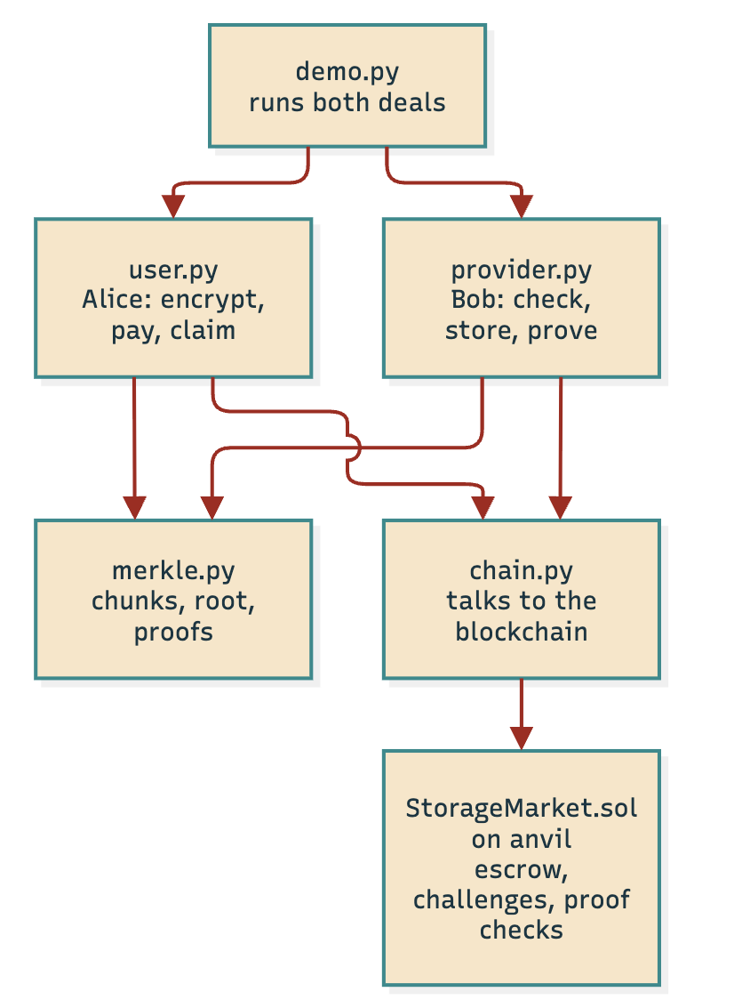
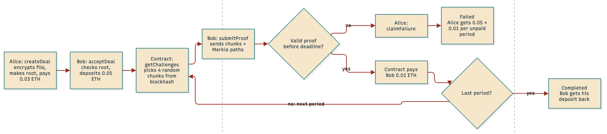
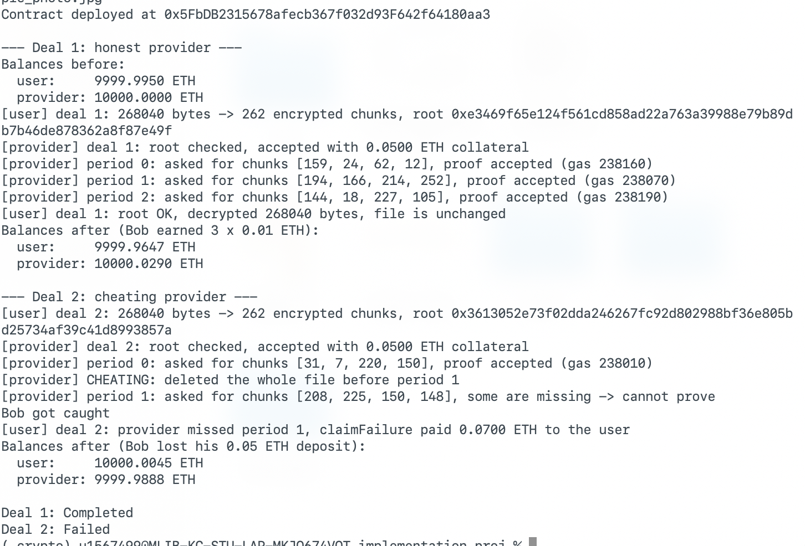

# Decentralized Storage Marketplace (Task 3, Solidity)

**Alice** has a file and wants **Bob** to store it for her. She does not trust Bob, so:
- she **locks** (encrypts) the file before giving it to him, so he cannot read it,
- she keeps only a short **fingerprint** of the file (the Merkle root),
- she pays into a **smart contract**, not to Bob directly,
- every period the contract asks Bob to show a few **random pieces** of the file,
- if Bob shows them, he gets paid for that period; if he cannot, Alice gets his deposit and her money back.

Testing, the cheating analysis and test results are in **[TESTING.md](TESTING.md)**.

---

## 1. Files

```
src/StorageMarket.sol     the smart contract: holds the money, picks random pieces, checks proofs, pays
offchain/user.py          Alice: lock the file, make the root, open the deal, get the file back, claim
offchain/provider.py      Bob: check the file, accept the deal, prove each period (can also cheat, for testing)
offchain/merkle.py        the Merkle tree: cut file into pieces, hash them, build proofs, check proofs
offchain/chain.py         helpers: start the local blockchain, deploy the contract, send transactions
offchain/demo.py          the demo: one honest deal and one cheating deal
offchain/bench.py         gas cost of each contract function, and a comparison of chunk sizes
offchain/analysis.py      how often a cheating Bob is caught (theory vs real deals) + detection_graph.png
test/StorageMarket.t.sol  21 tests for the contract
test/test_offchain.py     6 tests for the Python code (Merkle tree + full deals)
test/vectors.json         a small test tree written by merkle.py, used by both test files
TESTING.md                test results, cheating analysis
detection_graph.png       the graph made by analysis.py
sample_photo.png          an example file (1.33 MB) for the demo
foundry.toml              Foundry settings
requirements.txt          Python packages
```

Folders that are created, not written by hand:
```
lib/forge-std/   Foundry's test library, used by the contract tests (added with forge install)
out/, cache/     created by `forge build` (the compiled contract); not submitted
demo_data/       created when the demo runs: provider_inbox/ = Bob's encrypted copy,
                 user/ = Alice's root and key; not submitted
```

---

## 2. How it works, step by step (and where in the code)

<p align="center">
  
</p>

### Step 0: Start the blockchain
`demo.py` starts a local test blockchain (anvil), where Alice and Bob each get 10,000 test ETH,
and puts the contract on it.
- `chain.start_anvil()` starts the chain
- `chain.deploy()` deploys `StorageMarket.sol` (compiled by `forge build`)

### Step 1: Alice prepares her file
Alice locks the file, cuts it into pieces and makes its fingerprint.
- `user.create_deal()`
  - `encrypt()`: locks the file with AES-256-GCM and a random key
  - `merkle.chunk()`: cuts it into 1024-byte pieces (the last one is padded with zeros)
  - `merkle.build_tree()`: hashes each piece (`leaf`) and pairs of hashes (`node`) up to one hash
  - `merkle.root()`: that last hash is the **root**, the fingerprint of the whole file

### Step 2: Alice opens the deal and hands over the file
Alice pays for 3 periods (3 x 0.01 ETH) into the contract and gives Bob the locked file.
She keeps only the root and the key.
- `user.create_deal()` calls the contract's **`createDeal`**, which checks the settings and the payment
  and saves the deal
- the locked file goes to `demo_data/provider_inbox/` (Bob's storage)
- the root and the key go to `demo_data/user/` (all Alice keeps)

### Step 3: Bob checks the file and accepts
Bob rebuilds the root from the file he got. Only if it matches the root on the chain does he
accept and pay his 0.05 ETH deposit. (Otherwise Alice could set him up to fail and take his deposit.)
- `provider.run()`: `merkle.chunk()`, `merkle.build_tree()`, `merkle.root()`, compare with the deal
- contract **`acceptDeal`**: takes the deposit; period 0 starts at this block

### Step 4: Every period, a random check
1. Bob waits until the period's **seed block** exists (`periodWindow`, `chain.mine_until`).
2. The contract uses that block's hash to pick **4 random piece numbers** (**`getChallenges`**).
   Nobody knows them in advance, so Bob has to keep the whole file.
3. Bob builds a proof for each piece (`merkle.prove()`) and sends the pieces and proofs
   (**`submitProof`**).
4. The contract checks each piece with **`verifyChunk`**: hash the piece, go up the tree with the
   proof, and see if it ends at Alice's root.
5. All correct: Bob gets **0.01 ETH** for this period.

### Step 5: The non-cheat ending
After the last period, the contract also gives Bob his deposit back (deal state: **Completed**).
Alice gets her file back and checks it:
- `user.retrieve()`: rebuild the root and compare with the saved root, then `decrypt()` with her key

### Step 6: The cheating ending
Bob deletes the file (or part of it). In the next check he is asked for pieces he does not have,
and he cannot fake them (a fake piece gives a different root). The deadline passes.
- `provider.run(drop_after=1)`: Bob deletes the whole file before period 1
- `provider.run(cheat_fraction=0.5)`: Bob deletes half the pieces at the start
- `user.claim()` calls the contract's **`claimFailure`**, which pays Alice:

  **Bob's deposit (0.05) + 0.01 for every period Bob did not prove**

  (failed in period 0: 0.08, in period 1: 0.07, in period 2: 0.06). Deal state: **Failed**.

Because the deposit (0.05) is more than the whole payment (0.03), cheating always loses Bob money.
<p align="center">
  
</p>
---

## 3. How to run

You need **Foundry** and **Python 3.10 to 3.13** (web3 does not install on 3.14 and newer).

**1. Install Foundry** , then open a new terminal:
```bash
curl -L https://foundry.paradigm.xyz | bash
foundryup
```
If `forge` is not found later: `export PATH="$HOME/.foundry/bin:$PATH"`.

**2. Set up Python** (once, inside the project folder):
```bash
uv venv --python 3.12 .venv
source .venv/bin/activate
uv pip install -r requirements.txt
```

**3. Compile and test:**
```bash
forge build
forge test                      # 21 passed
python -m pytest test           # 6 passed
```
If `test/vectors.json` is missing, create it with `python offchain/merkle.py`.
If `forge-std/Test.sol` is not found, add the library with `forge install foundry-rs/forge-std --no-git`.

**4. Run the demo:**
```bash
python offchain/demo.py                            # 1 MB random file
python offchain/demo.py --file sample_photo.png    # your own file
python offchain/demo.py --cheat-fraction 0.5       # Bob deletes half the file
```

**5. Measurements and analysis:**
```bash
python offchain/bench.py                            # gas per function, chunk sizes
python offchain/analysis.py                         # cheating analysis + detection_graph.png (3-4 minutes)
```
---

## 4. Design decisions

| Decision | My choice | Why |
|---|---|---|
| Keeping the file secret | AES-256-GCM, random key, new random nonce | Bob and the chain only ever see locked data; GCM also detects any change |
| Chunk size | 1024 bytes | middle ground: smaller chunks are cheaper on-chain, bigger chunks make the tree faster to build (see measurements) |
| Merkle tree | leaf = hash(0, index, chunk), node = hash(1, left, right) | the 0/1 stops an inner node from being used as a leaf; the index ties each piece to its position |
| Random checks | hash(blockhash(seed block), deal, period, j) % number of chunks | the seed block does not exist when the deal starts, so Bob cannot know the checks in advance |
| Number of checks | 4 per period | if Bob deleted half the file, he is caught with 94% chance per period, 99.98% over 3 periods |
| Deadlines | 10 blocks per period (max 255) | `blockhash` only works for the last 256 blocks |
| Deposit | 0.05 ETH, more than the payment (0.03 ETH) | getting caught always costs Bob more than he could earn |
| Safety | update the deal before sending money, plus a reentrancy lock | stops a contract from calling back in and getting paid twice |

---

## 5. Measurements

From `python offchain/bench.py` (1 MB file, 4 checks per period).

**Gas per function** (1024-byte chunks):

| function | gas |
|---|---|
| createDeal | 184316 |
| acceptDeal | 31726 |
| submitProof | 243130 |
| claimFailure | 52688 |
| submitProof (last period) | 243040 |
| cancelDeal | 49355 |

**Chunk size comparison:**

| chunk size | chunks | proof depth | submitProof gas | calldata bytes | tree build (ms) | 4 proofs (ms) |
|---|---|---|---|---|---|---|
| 256 | 4096 | 12 | 150316 | 3236 | 831 | 0.01 |
| 1024 | 1024 | 10 | 243160 | 6052 | 218 | 0.009 |
| 4096 | 256 | 8 | 722490 | 18084 | 57 | 0.006 |

Smaller chunks mean Bob sends less data, so proofs are cheaper. But there are more pieces, so the
tree takes longer to build. 1024 bytes is in the middle.

The cheating analysis and test results are in [TESTING.md](TESTING.md).

## 6. Sample Output

