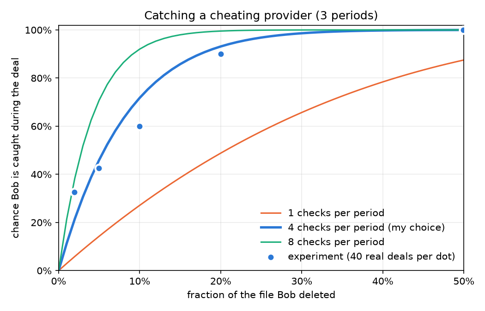

# Testing and Analysis

## 1. Tests

```bash
forge test               # contract tests
python -m pytest test    # Python tests
```

**Result:** all 21 contract tests passed.

The project has two kinds of tests. The 21 contract tests in `test/StorageMarket.t.sol` use
Foundry to check each rule of the contract on its own: they confirm that the Merkle proofs made
by the Python code are accepted by the contract and that any changed chunk, hash or position
fails; that an honest Bob is paid exactly 0.01 ETH after each good proof and gets his 0.05 ETH
deposit back at the end, while a bad proof moves no money; that every way of cheating is rejected
(a fake chunk, a real chunk at the wrong position, a proof that is too short or too long, reusing
last period's answer, answering too late or before the challenge is known, and a stranger sending
proofs); that if Bob misses a deadline, Alice receives his deposit plus the periods that were not
paid; that payments and deposits must be exact; and that an attacker contract cannot get its
refund twice. The 6 Python tests in `test/test_offchain.py` check that the Python Merkle tree
matches the contract and run full deals with a 1 MB file on a local blockchain: one where Bob is
honest and gets paid, one where he deletes the file and Alice is refunded, and one where Bob
refuses to accept a file that does not match the root.

---

## 2. How often is a cheating Bob caught?

```bash
python offchain/analysis.py
```

This runs real deals where Bob deletes part of the file, and counts how often he is caught
(4 checks per period, 3 periods, 40 deals per row):

| Bob deletes | caught |
|---|---|
| 2% | 13/40 = 32.5% |
| 5% | 17/40 = 42.5% |
| 10% | 24/40 = 60.0% |
| 20% | 36/40 = 90.0% |
| 50% | 40/40 = 100.0% |

- The more Bob deletes, the more often he is caught. Deleting half the file was caught every time.
- The experiment is close to the theory; the small differences come from using only 40 random
  deals per row.
- Bob is caught with 99% chance once he deletes 31.9% of the file or more. If he deletes
  everything, the first check catches him.
- Deleting only a small part can slip through, which is the limit of random checks.


